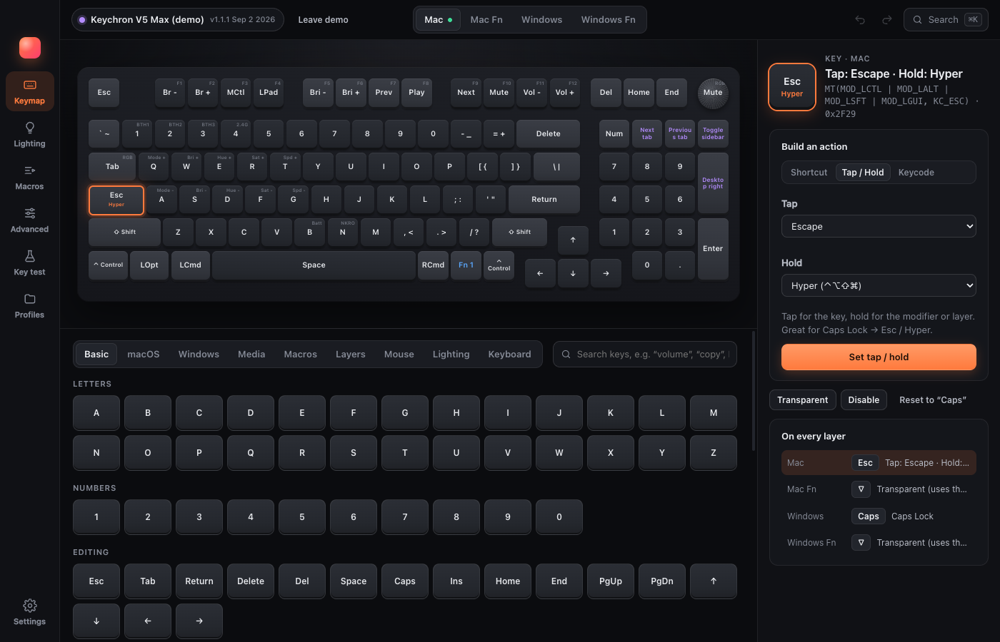
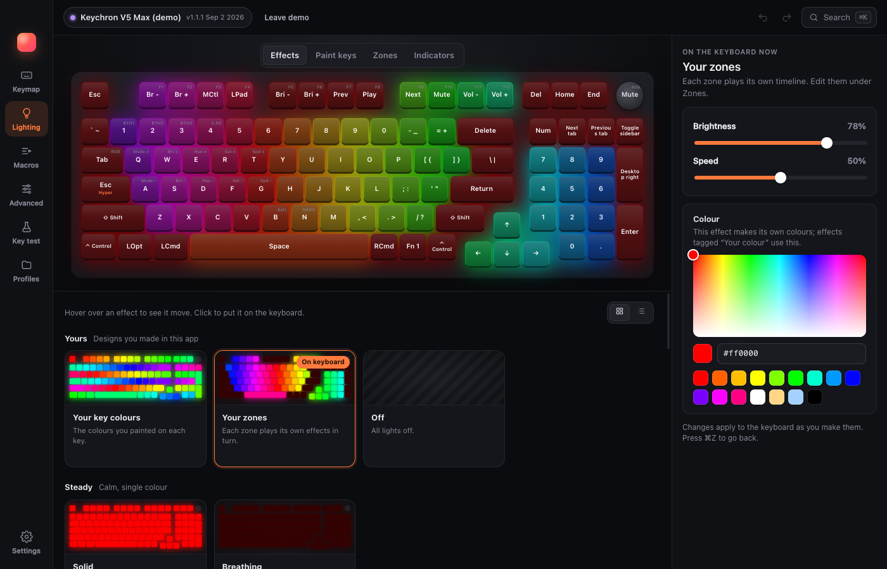
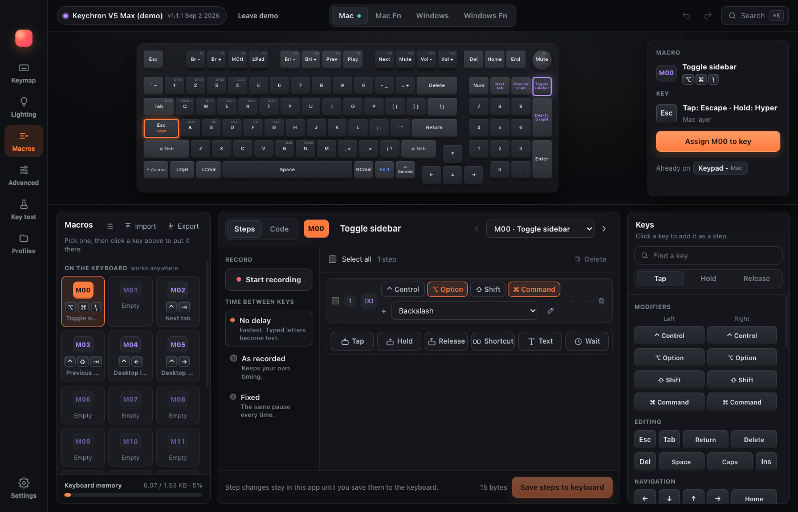

# Keytune

**Tune every key, light and macro on your Keychron or VIA keyboard.**

Keytune is a desktop app for configuring mechanical keyboards over USB. It speaks the open VIA protocol plus Keychron's extensions, so it works with Keychron's QMK keyboards and with the 2,000+ keyboards in [VIA's library](https://github.com/the-via/keyboards), without a browser and without flashing firmware.



## Features

- **Keymap**: every layer and knob, tap/hold keys, layer keys, media and mouse keys, with a searchable key picker.
- **Macros**: a Launcher-style editor for the keyboard's onboard macros. Record keystrokes, edit steps, type text, and see shortcuts as key caps. Import and export all your macros, names and app macros included, as a Keytune file, or swap onboard macros with Keychron Launcher and VIA.
- **App macros**: as many extra macros as you like, run by Keytune itself. They can hold and release keys, paste text, open files, apps or links, and run shell commands. They work in any app while Keytune is running (in the menu bar).
- **Lighting**: a gallery of effects that preview live, plus brightness, speed and colour. On Keychron boards you also get per-key painting, lighting zones and indicator lights.
- **Advanced** (Keychron): debounce, Snap Click, sleep timers and NKRO.
- **Key test**: see each switch register as you press it.
- **Profiles**: save, apply and share whole setups. Automatic backups are made every time a keyboard connects. VIA layout files import and export.
- **Any VIA keyboard**: when you plug in a keyboard Keytune doesn't know, it downloads the keyboard's layout from VIA's library, or you can add its VIA definition file (JSON) yourself.
- **Menu bar**: close the window and Keytune keeps running in the menu bar, so app macros keep working. Open it again or quit from the icon (turn this off in Settings).
- **Demo keyboard**: try everything without a keyboard attached.




## Supported keyboards

| Keyboard | What works |
| --- | --- |
| Keychron V5 Max | Everything (definition built in) |
| Other Keychron QMK keyboards | Everything their firmware offers (layout downloaded from VIA's library, or add Keychron's definition file) |
| Any other keyboard running VIA firmware (protocol 9+) | Keymap, layers, knobs, macros, app macros and lighting effects |
| Keyboards without VIA firmware | Not supported |

Wireless keyboards must be connected with a cable to change settings. Close Keychron Launcher, VIA and Vial while Keytune is open, because only one app can talk to the keyboard at a time.

## Project status

Keytune is early (0.x). Development so far has been tested against a faithful simulator of the keyboard firmware (`src/shared/simulator.ts`) and real VIA definition files, not yet across a range of physical keyboards. Reports from real hardware are very welcome: please [open an issue](../../issues).

- **macOS** (Apple silicon) is the main platform. App macros need permission under System Settings → Privacy & Security → Accessibility.
- **Windows** has code paths but has never been run.
- **Linux** may work for keyboard configuration; app macros are not supported there.

## Install

Download the latest build from [Releases](../../releases), unzip it and move Keytune to Applications. Builds are not signed with an Apple Developer ID, so macOS blocks the first launch. Open the app once, then go to System Settings → Privacy & Security and click **Open Anyway** next to the Keytune message. (On macOS 14 and earlier you can instead right-click the app in Finder and choose **Open**.)

## Build from source

You need Node.js 22 or newer.

```sh
npm install
npm test           # unit tests (vitest)
npm run check      # TypeScript type check
npm run dev        # build and launch the app
npm run package:mac   # package release/Keytune-darwin-arm64/Keytune.app and smoke-test it
```

With no keyboard attached, choose **Try the demo keyboard** on the connect screen.

## How it works

- `src/shared/protocol`: the VIA and Keychron raw HID commands (32-byte reports on usage page `0xFF60`).
- `src/shared/keyboard.ts`: reads a keyboard's whole state and applies every change immediately.
- `src/shared/simulator.ts`: an in-memory keyboard that answers reports the way the firmware does; it powers the tests and the demo keyboard.
- `src/main`: the Electron main process (USB permission, settings, profiles, app macros).
- `src/renderer`: the React interface.

## Privacy

Keytune has no accounts, analytics or telemetry. Its only network request is looking up an unrecognised keyboard's layout at `usevia.app`. Settings and profiles stay on your computer.

## Contributing

See [CONTRIBUTING.md](CONTRIBUTING.md). Security issues: see [SECURITY.md](SECURITY.md).

## Licence

Keytune is free software under the [GNU General Public License v3.0 or later](LICENSE). It includes data derived from QMK and VIA; see [THIRD_PARTY_NOTICES.md](THIRD_PARTY_NOTICES.md).

Keytune is an independent project and is not affiliated with or endorsed by Keychron or VIA. Keychron is a trademark of its owner; it is used here only to describe compatibility.
